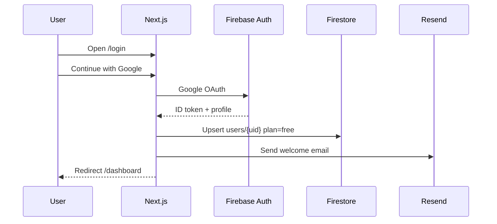
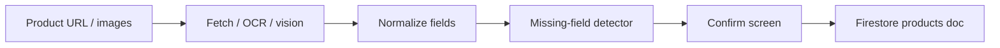
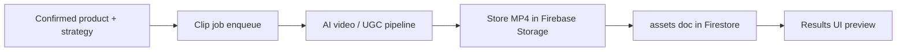
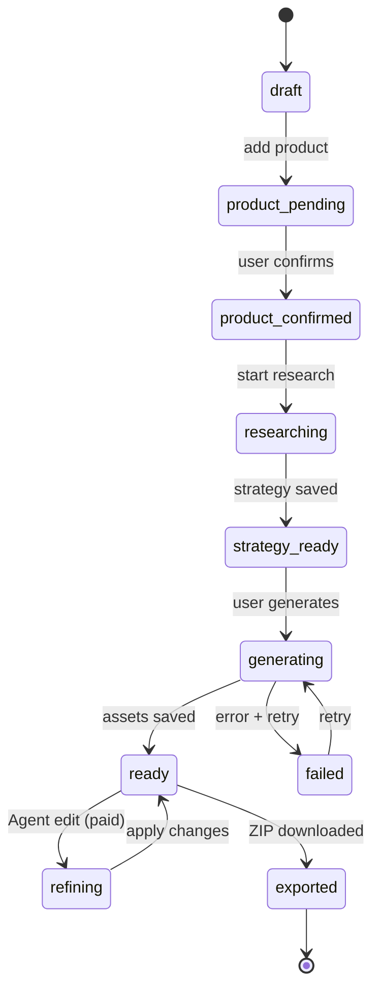
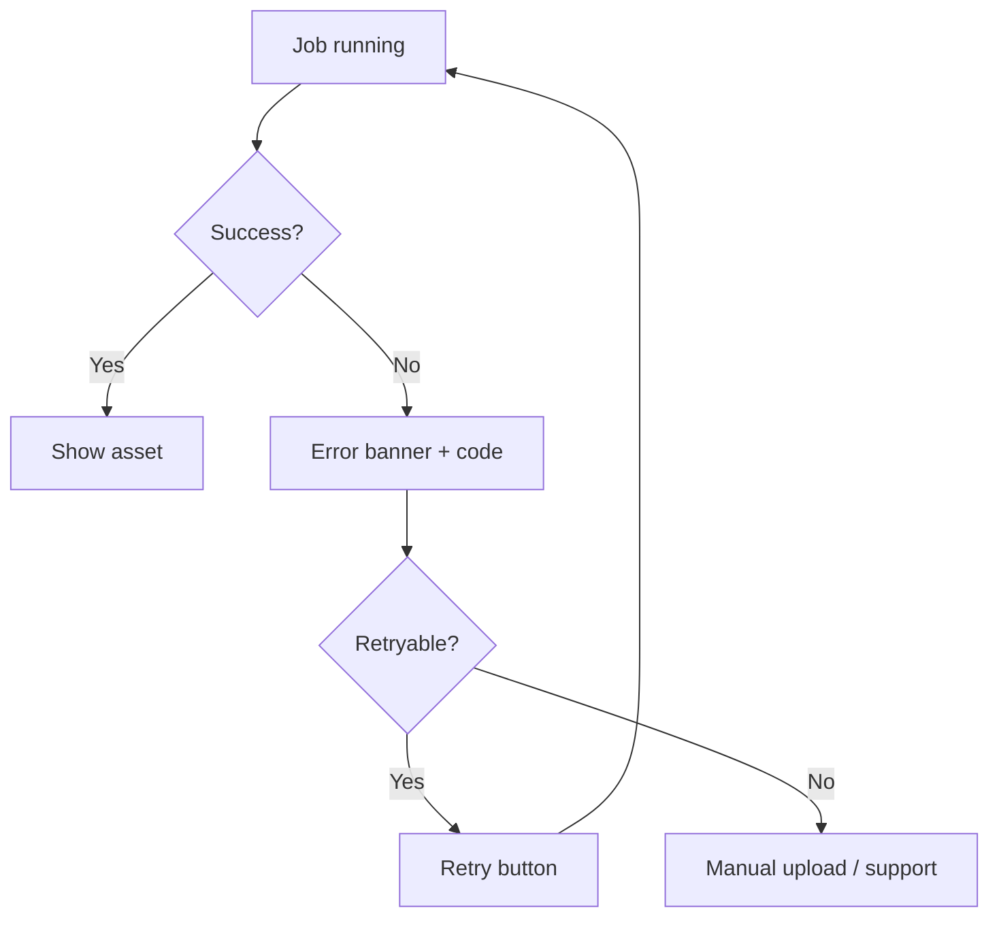

# LUCE — App Flow Document

**Version:** 1.0  
**Date:** October 2026  
**Sources audited:** Current marketing landing (`src/App.tsx` anchors) + PRD v2.0 MVP app routes (Next.js target)

---

## 1. Audit Summary

### 1.1 Current landing (Vite / marketing shell)

Single-page marketing surface with hash anchors (not full app routes yet):

| Anchor / ID | Section purpose |
|-------------|-----------------|
| `#top` / hero | Brand, product URL / image CTA |
| `#how-it-works` | Workflow explanation |
| `#ugc` | Creator video marquee |
| `#outputs` | What you get (campaign pack) |
| `#features` | Why LUCE |
| `#audience` | Who it’s for |
| `#pricing` | Free / Starter / Pro plans |
| `#faq` | FAQ |
| `#cta` | Final CTA |
| `#login` | Login affordance (placeholder) |

Nav: How it works · What you get · Pricing · FAQ  

### 1.2 Target application routes (Next.js App Router)

These are the **product app** routes derived from the PRD end-to-end journey.

| Route | Auth | Purpose |
|-------|------|---------|
| `/` | Public | Marketing landing |
| `/login` | Public | Email + **Google (Gmail)** sign-in |
| `/signup` | Public | Account create |
| `/dashboard` | Required | Saved campaigns list |
| `/campaigns/new` | Required | Create campaign |
| `/campaigns/new/product` | Required | Add URL or upload images |
| `/campaigns/[id]/confirm` | Required | Confirm product understanding |
| `/campaigns/[id]/research` | Required | Research + smart questions |
| `/campaigns/[id]/strategy` | Required | Review / approve strategy |
| `/campaigns/[id]/generate` | Required | Select assets / generate |
| `/campaigns/[id]/results` | Required | Review grouped assets |
| `/campaigns/[id]/refine` | Plan-gated | Agent conversational refine |
| `/campaigns/[id]/download` | Required | ZIP export |
| `/settings` | Required | Profile |
| `/billing` | Required | Plans / Paid plans |
| `/api/*` | Server | Node handlers (auth verify, jobs, webhooks) |

---

## 2. Primary User Flow (MVP)

```mermaid
flowchart TD
  A[Landing /] --> B{Authenticated?}
  B -->|No| C[/login — Google Gmail / email]
  C --> D[Firebase Auth]
  D --> E[/dashboard]
  B -->|Yes| E
  E --> F[/campaigns/new]
  F --> G[Add product URL or images]
  G --> H[Product understanding — Transcribe / extract]
  H --> I[/confirm — edit or confirm]
  I --> J[Research and smart questions]
  J --> K[Build campaign strategy]
  K --> L[Generate — Clipping + visuals + social + ads]
  L --> M[/results — preview / regenerate]
  M --> N{Refine?}
  N -->|Starter+| O[/refine — Campaign Agent]
  O --> M
  N -->|No| P[/download — ZIP]
  P --> Q[Manual publish off-platform]
  M --> R[Saved in Firestore + Storage]
  R --> E
```

---

## 3. Module Flows

### 3.1 Auth Module (Gmail enable)



### 3.2 Transcribe Module (product understanding + captions)

**Role in LUCE:** Extract structured product fields from URL/HTML/images (and later video captions for UGC).



### 3.3 Clipping Module (video / UGC creative clips)

**Role in LUCE:** Generate short-form video / UGC-style clips tied to confirmed product + strategy.



### 3.4 Plans / Paid Plans

```mermaid
flowchart TD
  A[User hits Generate] --> B{Plan quota OK?}
  B -->|No| C[/billing — upgrade CTA]
  C --> D[Paid plan activated]
  D --> E[usage reset / higher limits]
  B -->|Yes| F[Increment usage]
  F --> G[Run generation jobs]
```

---

## 4. Campaign Agent Orchestration Flow



---

## 5. Landing → App Handoff

| Landing CTA | Target |
|-------------|--------|
| Create campaign / Get started | `/signup` or `/campaigns/new` |
| Log in | `/login` |
| Pricing CTAs | `/signup?plan=starter` or `/billing` |

---

## 6. Error / Retry Flow (UX)



---

## 7. Data Flow (system)

`User → Product URL/Image → Understanding (Transcribe) → Confirm → Research → Strategy → Generation (Clipping + visuals + copy) → Results → Regenerate/Download → Firebase + Storage`

Matches PRD conceptual architecture.

---

*End of App Flow v1.0*
