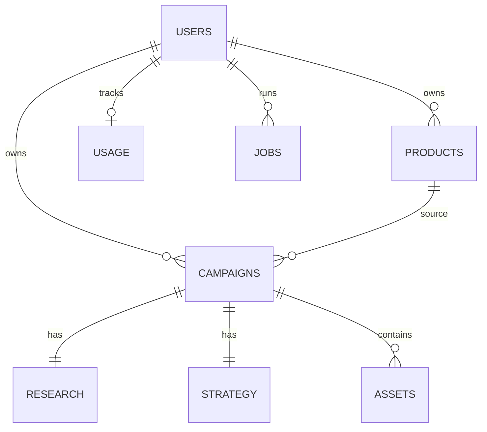

# LUCE — Background Schema Document

**Version:** 1.0  
**Date:** October 2026  
**Database:** Firebase Firestore  
**Blob storage:** Firebase Storage  
**Auth:** Firebase Authentication  

---

## 1. Purpose

Defines data models, storage paths, and access control for the LUCE MVP so implementation and academic review share one schema source of truth.

**Logical flow (PRD):**  
`USER → PRODUCT → CAMPAIGN → STRATEGY / RESEARCH → ASSETS → DASHBOARD → DOWNLOAD`

---

## 2. Entity Relationship (overview)



---

## 3. Data Models (Firestore)

Collection paths use snake_case document fields unless noted.

### 3.1 `users/{userId}`

| Field | Type | Notes |
|-------|------|-------|
| `email` | string | From Auth |
| `displayName` | string | Optional |
| `photoURL` | string | Optional (Google) |
| `plan` | `"free" \| "starter" \| "pro"` | Default `free` |
| `planRenewsAt` | timestamp | Nullable |
| `createdAt` | timestamp | Server |
| `updatedAt` | timestamp | Server |
| `authProvider` | `"google" \| "password"` | |

### 3.2 `products/{productId}`

| Field | Type | Notes |
|-------|------|-------|
| `userId` | string | Owner |
| `sourceType` | `"url" \| "upload"` | |
| `sourceUrl` | string | Nullable |
| `name` | string | |
| `description` | string | |
| `features` | string[] | |
| `category` | string | |
| `price` | string \| number | As extracted |
| `brand` | string | Optional |
| `tone` | string | Optional |
| `imagePaths` | string[] | Storage paths |
| `confirmed` | boolean | After confirm step |
| `rawExtract` | map | Transcribe module output |
| `createdAt` / `updatedAt` | timestamp | |

### 3.3 `campaigns/{campaignId}`

| Field | Type | Notes |
|-------|------|-------|
| `userId` | string | |
| `productId` | string | |
| `title` | string | Default from product name |
| `status` | enum | See §3.8 |
| `selectedAssets` | string[] | Asset type keys |
| `progressStep` | string | UI stage label |
| `errorCode` | string | Nullable |
| `zipPath` | string | Storage path when ready |
| `createdAt` / `updatedAt` | timestamp | |

### 3.4 `campaigns/{campaignId}/research/summary` (or map on campaign)

| Field | Type | Notes |
|-------|------|-------|
| `market` | string | |
| `competitors` | array\<map\> | Observed vs recommended flagged |
| `trends` | string | |
| `questionsAsked` | array\<map\> | Q/A pairs |
| `recommendations` | map | Audience / positioning options |
| `createdAt` | timestamp | |

### 3.5 `campaigns/{campaignId}/strategy/current`

| Field | Type | Notes |
|-------|------|-------|
| `objective` | string | |
| `audience` | string | |
| `insight` | string | |
| `positioning` | string | |
| `angle` | string | |
| `message` | string | |
| `creativeDirection` | string | |
| `cta` | string | |
| `updatedAt` | timestamp | |

### 3.6 `campaigns/{campaignId}/assets/{assetId}`

| Field | Type | Notes |
|-------|------|-------|
| `type` | enum | `product_image`, `lifestyle_image`, `promo_creative`, `ugc_video`, `reels_video`, `marketing_video`, `caption`, `hook`, `cta`, `hashtags`, `ad_creative`, `ad_copy` |
| `module` | `"clipping" \| "transcribe" \| "visual" \| "copy"` | Origin pipeline |
| `status` | `"queued" \| "running" \| "ready" \| "failed"` | |
| `storagePath` | string | Blob path (media) |
| `text` | string | For copy assets |
| `thumbPath` | string | Optional |
| `meta` | map | Duration, size, model ids |
| `createdAt` / `updatedAt` | timestamp | |

### 3.7 `usage/{userId}_{yyyy_mm}`

| Field | Type | Notes |
|-------|------|-------|
| `userId` | string | |
| `period` | string | `2026-10` |
| `campaignsCreated` | number | |
| `regenerations` | number | |
| `clippingJobs` | number | |
| `transcribeJobs` | number | |
| `limits` | map | Snapshot of plan caps |

### 3.8 Campaign `status` enum

`draft` → `product_pending` → `product_confirmed` → `researching` → `strategy_ready` → `generating` → `ready` → `exported`  
Plus: `partial`, `failed`

### 3.9 `jobs/{jobId}` (optional queue mirror)

| Field | Type | Notes |
|-------|------|-------|
| `userId` | string | |
| `campaignId` | string | |
| `module` | `"clipping" \| "transcribe" \| "research" \| "strategy" \| "visual" \| "zip"` | |
| `status` | string | |
| `attempts` | number | |
| `lastError` | string | |
| `createdAt` / `updatedAt` | timestamp | |

---

## 4. Storage / Blob Layout (Firebase Storage)

```
users/{userId}/
  products/{productId}/
    source/{filename}          # original uploads / scraped images
  campaigns/{campaignId}/
    assets/{assetId}/{file}    # images, mp4
    exports/campaign.zip       # final ZIP
```

| Rule | Detail |
|------|--------|
| Content types | `image/jpeg`, `image/png`, `image/webp`, `video/mp4`, `application/zip` |
| Max upload (MVP) | Images ≤ 10MB each; video outputs server-written |
| Naming | UUID filenames to avoid collisions |
| ZIP structure | `/visuals`, `/videos`, `/social`, `/ads`, `/strategy.pdf|md`, `manifest.json` |
| Access | Private; download via **signed URLs** (short TTL) |

---

## 5. Access Control

### 5.1 Principles

1. Every product, campaign, asset, and usage doc is owned by `userId`  
2. Clients never get blanket Admin access  
3. Server Admin SDK used for privileged AI writes  
4. Plan gates enforced server-side before jobs  

### 5.2 Firestore Rules (sketch)

```
rules_version = '2';
service cloud.firestore {
  match /databases/{database}/documents {
    function isOwner(uid) {
      return request.auth != null && request.auth.uid == uid;
    }

    match /users/{userId} {
      allow read, update: if isOwner(userId);
      allow create: if isOwner(userId);
    }

    match /products/{productId} {
      allow read, write: if isOwner(resource.data.userId)
        || (request.method == 'create' && isOwner(request.resource.data.userId));
    }

    match /campaigns/{campaignId} {
      allow read, write: if isOwner(resource.data.userId)
        || (request.method == 'create' && isOwner(request.resource.data.userId));

      match /{sub=**} {
        allow read, write: if isOwner(get(/databases/$(database)/documents/campaigns/$(campaignId)).data.userId);
      }
    }

    match /usage/{docId} {
      allow read: if isOwner(resource.data.userId);
      allow write: if false; // server only
    }

    match /jobs/{jobId} {
      allow read: if isOwner(resource.data.userId);
      allow write: if false; // server only
    }
  }
}
```

### 5.3 Storage Rules (sketch)

```
rules_version = '2';
service firebase.storage {
  match /b/{bucket}/o {
    match /users/{userId}/{allPaths=**} {
      allow read, write: if request.auth != null && request.auth.uid == userId
        && request.resource.size < 15 * 1024 * 1024;
    }
  }
}
```

*(Server-generated videos/ZIPs may be written with Admin SDK and read via signed URLs.)*

### 5.4 API access

| Endpoint class | Auth | Extra |
|----------------|------|-------|
| Public marketing | None | |
| `/api/campaigns/*` | Bearer Firebase ID token | Plan check |
| `/api/billing/*` | Auth | |
| Webhooks | Shared secret | |

### 5.5 Plan-based access

| Capability | Free | Starter+ |
|------------|------|----------|
| Campaigns / month | 1 (PRD) | Higher |
| Basic research | Yes | Yes |
| Agent refine | No | Yes |
| Regenerations | Limited | Higher |
| Clipping jobs | Limited | Higher |
| ZIP download | Yes (watermark optional) | Full |

---

## 6. Indexes (planned)

- `campaigns`: `userId` ASC + `updatedAt` DESC  
- `assets`: `campaignId` + `type`  
- `jobs`: `status` + `updatedAt` (if queried)

---

## 7. Privacy & Retention (MVP)

- User can delete account → cascade delete products, campaigns, storage prefix  
- Logs retain IDs not raw media  
- Export download links expire (e.g. 60 minutes)

---

*End of Background Schema v1.0*
